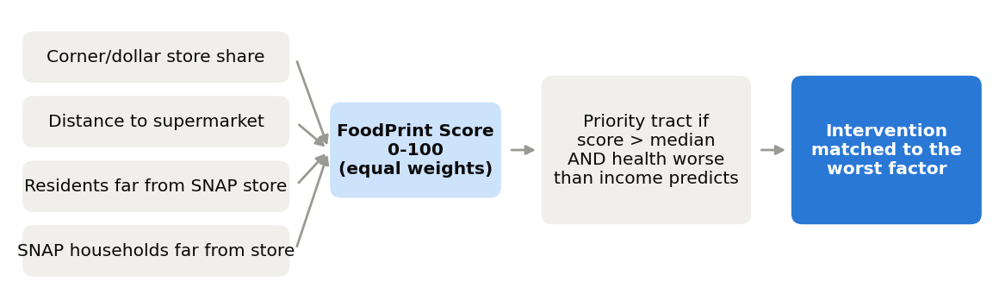
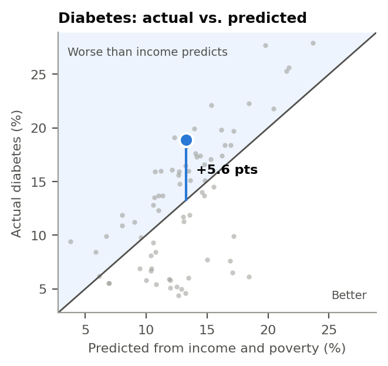
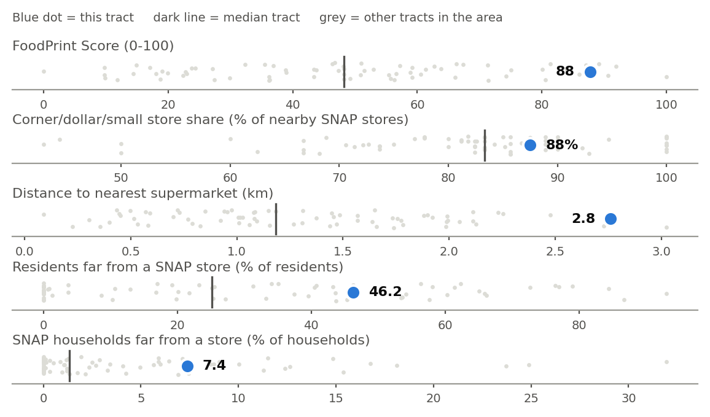
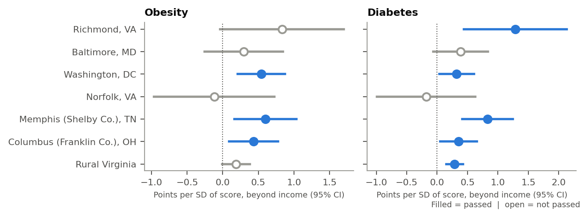
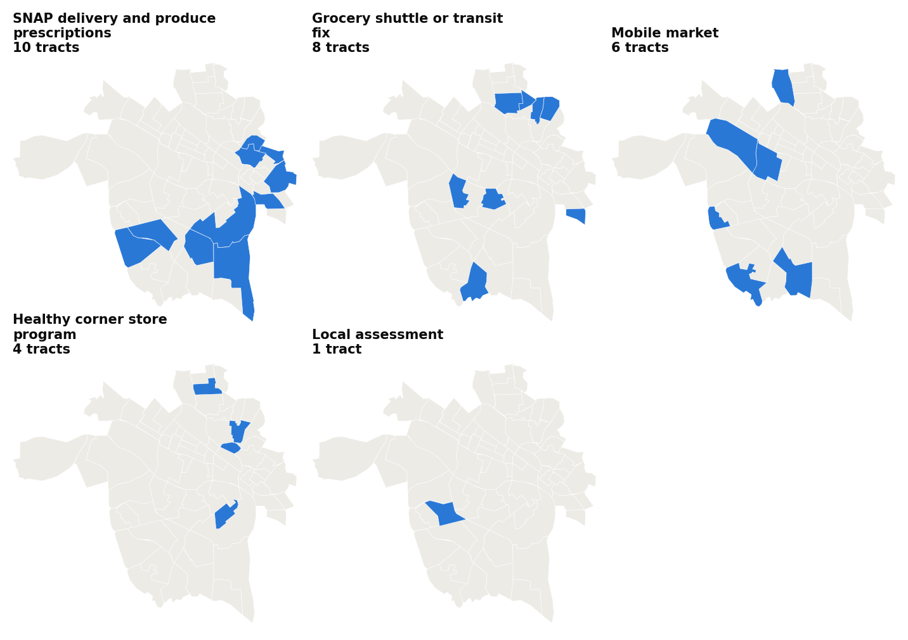

# FoodPrint Score

**Which neighborhoods should a hospital or health department target with food-access programs, and what kind of program fits each one?**

Hospitals already know where poverty is. What they don't know is where the *food environment* (which stores are nearby, how far the supermarket is, whether SNAP households can reach a store) is linked to worse health **beyond what income already explains**. That's where a food program has the best chance of helping.

The FoodPrint Score answers that for every census tract (a neighborhood of roughly 4,000 people) using only public data. For each priority tract it recommends a specific intervention and gives the numbers behind it. The dashboard shows the results, and the reports can be downloaded as PDFs for a hospital's Community Health Needs Assessment (CHNA).

It's a tool for deciding **where to look first**. It does not show that food access *causes* obesity or diabetes.

---

## How it works



1. **Four factors, measured for every tract.** Each is set up so a higher value means a worse food environment.

   | Factor | What it measures | Why it matters |
   |---|---|---|
   | Corner/dollar/small store share | Share of nearby SNAP-accepting stores that are convenience, dollar or small stores | Mostly packaged food close to home |
   | Distance to nearest supermarket | Kilometers to the closest full-service grocery store | Fresh food is hard to reach |
   | Residents far from a SNAP store | % of residents more than 1/2 mile (10 miles in rural areas) from any SNAP store | No store within reach at all |
   | SNAP households far from a store | % of households on SNAP *and* far from a store | Cost and distance hit the same families (our stand-in for affordability) |

2. **FoodPrint Score (0-100).** The four factors are standardized within the area and averaged with equal weights, so 100 means the worst food environment *in that area*, not nationally.

3. **Health beyond income.** For each tract we predict obesity and diabetes from income and poverty alone. The gap between actual and predicted ("excess") is the part income doesn't explain.

   

   *Each dot is a Richmond tract. Dots above the line have more diabetes than their income predicts. Blue is Tract 708.02.*

4. **Priority tract** = score above the area median **and** a positive excess.

5. **Recommendation.** The tract's worst factor decides the intervention. A factor counts if the tract is in the worst 30% of its area on it.

   | Worst factor | Recommended intervention |
   |---|---|
   | Corner/dollar store share | Healthy corner store program |
   | Distance to supermarket | Grocery shuttle or transit fix |
   | Residents far from a SNAP store | Mobile market |
   | SNAP households far from a store | SNAP delivery and produce prescriptions |
   | None stands out | Local assessment (talk to residents first) |

   This is how one tract looks in its report. Tract 708.02 in Richmond is far from a supermarket, so it gets a grocery shuttle or transit fix:

   

---

## Does it work? Validation

We built the score on **Richmond, VA** and **Baltimore, MD**, then **locked it** and tested it on areas it had never seen: Washington DC, Norfolk VA, Memphis (Shelby County) TN, Columbus (Franklin County) OH and all rural Virginia tracts.

An area **passes** if, after controlling for income and poverty, both of these hold:
- the score still predicts the outcome in a spatial regression (95% confidence interval above zero), and
- adding the score lowers leave-one-out prediction error.



| Area | Tracts | Obesity | Diabetes | Priority list | Priority tracts | Residents |
|---|---:|:---:|:---:|---|---:|---:|
| Richmond, VA (built here) | 73 | - | pass | released, ranked on diabetes | 29 | 87,239 |
| Baltimore, MD (built here) | 193 | - | - | **withheld** | - | - |
| Washington, DC | 198 | pass | pass | released | 72 | 247,290 |
| Norfolk, VA | 74 | - | - | **withheld** | - | - |
| Memphis (Shelby Co.), TN | 242 | pass | pass | released | 76 | 322,248 |
| Columbus (Franklin Co.), OH | 325 | pass | pass | released | 98 | 431,371 |
| Rural Virginia | 614 | - | pass | released, ranked on diabetes | 159 | 514,209 |

**What this means:** the score works in the three large held-out metros and for diabetes in rural Virginia. It does **not** work in Norfolk, where about a third of tracts have only convenience or dollar stores nearby, so the store mix barely varies. Where an area doesn't pass, the dashboard shows the scores but gives no ranking or recommendations.

---

## What you get

**Dashboard** (`dashboard/app.py`), one area at a time:

| Tab | Shows |
|---|---|
| Recommendations | Residents covered by each intervention, plus a map that highlights the tracts for the intervention you pick |
| Map | Score, excess obesity, obesity or diabetes for every tract |
| Priority list | Ranked tracts with their recommended intervention (CSV download) |
| Tract detail | Where the tract sits on each factor, actual vs predicted health, and validation for the area |
| Evidence | Validation for every area |
| Data & limits | Method diagram, sources and limitations |

**PDF reports**, downloadable from the dashboard:
- **Area report:** priority tracts, residents per intervention, a small map for each intervention, the ranked list, validation and method.
- **Tract report:** the recommendation, the tract on every factor, actual vs predicted health, validation, data and limitations.



---

## Quick start: just the dashboard

All dashboard inputs are committed, so you don't need API keys or raw data.

```bash
python3 -m pip install -r dashboard/requirements.txt
python3 -m streamlit run dashboard/app.py
```

It opens at http://localhost:8501. To make sample PDFs without the dashboard, run `python3 src/reports.py richmond` (they're written to `outputs/reports/`).

---

## Reproducing the results

You need a free Census API key (`cp .env.example .env`, then paste the key) and two raw USDA downloads in `data/raw/`: the Food Access Research Atlas Excel file and the Historical SNAP Retailer Locator CSV. Links are at the top of `src/02_extract_fara.py` and `src/05b_snap_store_features.py`.

```bash
python3 -m pip install -r requirements.txt

# per city (richmond, baltimore, dc, norfolk, memphis, columbus; see src/regions.py)
python3 src/01_pull_places_acs.py richmond      # CDC PLACES + Census ACS
python3 src/02_extract_fara.py richmond         # USDA Food Access Research Atlas
python3 src/03_download_osm_internet.py richmond
python3 src/04_clean_osm.py richmond
python3 src/05_build_features.py richmond
python3 src/05b_snap_store_features.py richmond # store mix + supermarket distance
python3 src/06_score_and_validate.py richmond

# rural Virginia (one script replaces 01, 03, 05b, 06; uses 10-mile rules)
python3 src/02_extract_fara.py rural_va
python3 src/01r_rural_virginia.py

# final results
python3 src/10_all_cities.py      # validation in every area
python3 src/12_final_scores.py    # scores, priority lists, recommendations, dashboard files
```

Steps 07-09 and 11 are the research steps that led to the final score (robustness checks, comparing score versions, choosing the store-type factors, presentation figures). You don't need them to rebuild the dashboard.

### Repository layout

```
dashboard/app.py          Streamlit dashboard (reads outputs/ only; does no modeling)
src/
  regions.py              study areas (FIPS codes)
  01-06, 01r              data pulls and per-city features
  07-09, 11               research steps: robustness, score selection, figures
  10_all_cities.py        validation in every area (spatial error model + leave-one-out)
  12_final_scores.py      final scores, priority lists, recommendations, dashboard files
  recommendations.py      rules: worst factor -> intervention (change these to change the advice)
  reports.py, charts.py   PDF reports and their charts
data/processed/<area>/    tract-level tables (committed)
data/raw/                 large USDA downloads (not in git)
outputs/dashboard/        everything the dashboard reads
outputs/<area>/           ranked lists, validation write-ups, figures
outputs/all_cities/       validation results for every area
docs/                     data inventory, test plans, README images
```

---

## Data

| Source | Used for | Vintage |
|---|---|---|
| CDC PLACES (tract) | obesity and diabetes prevalence (outcomes) | 2025 release (2023 BRFSS) |
| Census ACS 5-year | median household income, poverty rate (the income baseline) | 2019-2023 |
| USDA Food Access Research Atlas | residents and SNAP households far from a SNAP store | 2025 release |
| USDA SNAP Retailer Locator (historical) | store type and location; stores open June 30, 2023 | 2005-2025 |
| Census TIGER/Line | tract boundaries | 2020 |

More detail and data-quality notes are in [`docs/data_inventory.md`](docs/data_inventory.md).

## Limitations

- **Not causal.** The score shows where to look. A funded pilot with an evaluation is the real test.
- **Tracts, not people.** Results describe neighborhoods, not individual residents.
- **Modeled outcomes.** CDC PLACES values are small-area estimates, not clinical counts.
- **No price data.** Affordability is approximated by SNAP households far from a store.
- **Store lists lag.** Openings and closures can take years to show up. Check locally before funding anything.
- **Cars change the picture.** Distance matters less where most households drive.
- **Coverage.** PLACES has no 2023 data for Pennsylvania, so Philadelphia is excluded. The rural test covers Virginia only.
